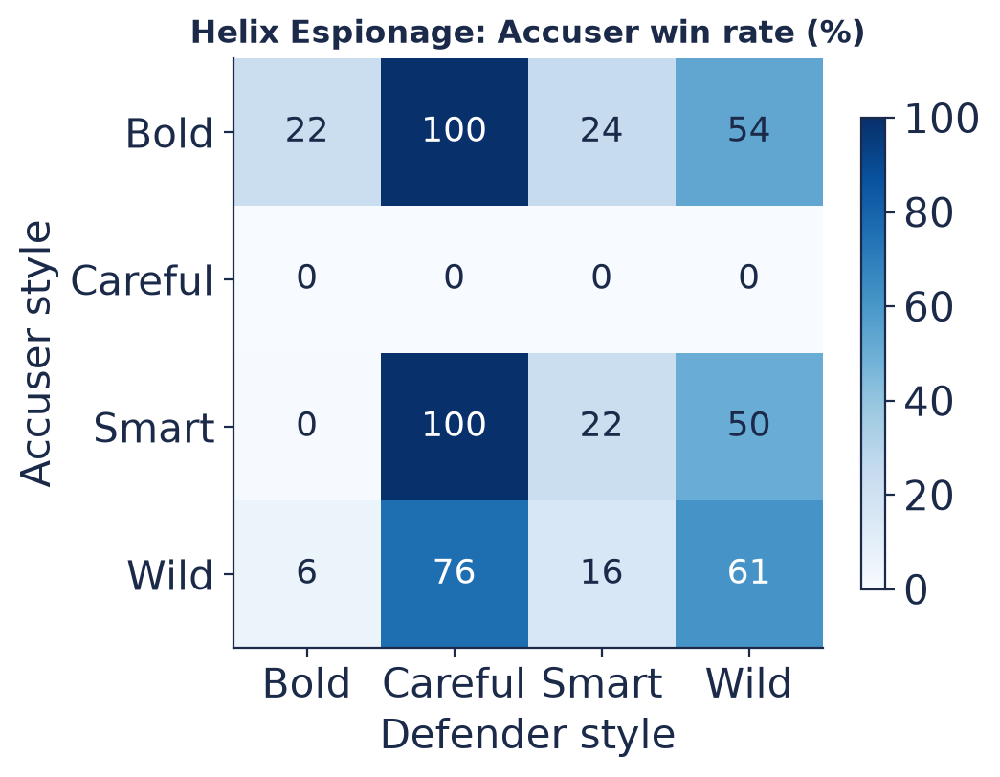
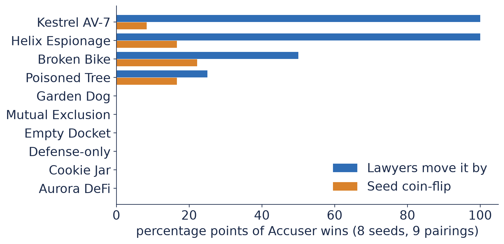
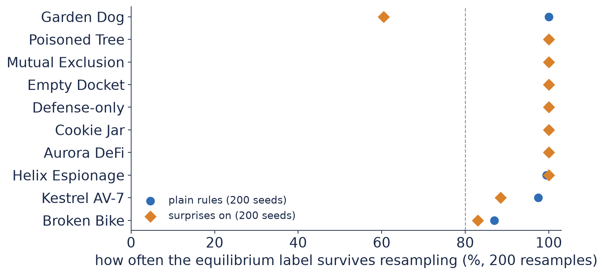
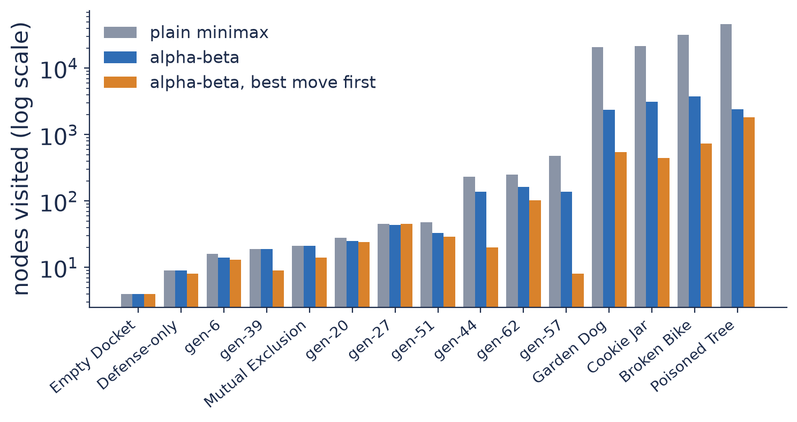

<div align="center">

# ⚖️ Saul Goodman Courtroom

### Two AI lawyers. One rulebook judge. Exact game theory.

*A simulated trial played as a strategic game, a deterministic judge that shows its working,
and a 3D courtroom where you can watch every move.*

[](https://ai-project-weld-omega.vercel.app)


**CS F407 Artificial Intelligence · Team 22 · BITS Pilani, Hyderabad Campus**
Track: Demo · Domain: Agents & Game Theory

</div>

---

## Table of contents

1. [What is this?](#-what-is-this)
2. [Try it in 60 seconds](#-try-it-in-60-seconds)
3. [Features at a glance](#-features-at-a-glance)
4. [How a trial works](#-how-a-trial-works)
5. [The four playing styles](#-the-four-playing-styles)
6. [How the judge decides](#-how-the-judge-decides)
7. [Game theory: which style wins?](#-game-theory-which-style-wins)
8. [The web app](#-the-web-app)
9. [The case library](#-the-case-library)
10. [Command-line tools](#-command-line-tools)
11. [HTTP API](#-http-api)
12. [Architecture and team](#-architecture-and-team)
13. [Robustness and verification](#-robustness-and-verification)
14. [AI usage disclosure](#-ai-usage-disclosure)
15. [Deploying](#-deploying)
16. [Project layout](#-project-layout)
17. [Documentation index](#-documentation-index)

---

## 🧭 What is this?

Pick a fictional case, choose how each lawyer plays, and watch the trial unfold step by step.

- A **prosecution agent** and a **defense agent** compete to build the strongest case from structured, synthetic evidence. They
  present exhibits, object, challenge witnesses and rest, each under a fixed **budget** and with only a noisy view of the other
  side's hidden flaws.
- The **judge is not a language model.** It is a fully deterministic rulebook that uses exact fractions: it rules on every
  objection with a named rule, weighs only the accepted evidence, and records every step in a **hash-chained audit trail**.
  Same case, same choices, same seed: same verdict, every time.
- A **game-theory layer** replays each case for every pairing of styles, builds the payoff matrix and solves it for **exact
  rational Nash equilibria**, then checks how stable they are.

That answers the question the whole demo is built around:

> **Should a lawyer go on the attack, or play it safe?**

<p align="center">
  
</p>

---

## 🚀 Try it in 60 seconds

**Just look:** open the hosted site, <https://ai-project-weld-omega.vercel.app>, pick a case, brief your lawyers and click
**Enter the courtroom**. It plays recorded trials, with voices and music, in any modern browser.

**Run everything locally** (Python 3.11 or newer):

```bash
git clone https://github.com/AI-Projects-S1-26-27/T22_SAUL_GOODMAN.git
cd T22_SAUL_GOODMAN
pip install -e ".[dev]"
python -m courtroom serve          # open http://127.0.0.1:8000
```

The local server runs the **live simulator**: the page shows a green **LIVE** badge and every trial, table and search is
computed in front of you.

**Check it:**

```bash
python -m pytest -q                         # the full test suite
python scripts/preflight.py                 # a pass/fail list of everything the demo needs
python -m playwright install chromium       # only needed for the browser tests
```

---

## ✨ Features at a glance

| | Feature | What you get |
|---|---|---|
| 🏛️ | **3D courtroom** | three.js room with judge, lawyers, bailiff and witnesses; camera cuts, witness walk to the stand, oath, exhibit cards with stamps |
| 🎙️ | **Pre-recorded voices** | Every spoken line recorded with a fixed voice per character, so every device hears the same trial |
| 🎵 | **Synthesised score** | Web Audio soundtrack that ducks under speech, with verdict themes that start the moment the verdict appears |
| 🧑‍⚖️ | **Exact rulebook judge** | Rational arithmetic, named rules for every ruling, a directed-verdict review, a tamper-evident hash chain |
| 🤖 | **Four strategic lawyers** | Bold, Careful, Smart (Bayesian, learns the opponent) and Wild, plus a test-only chaos agent |
| ♟️ | **Exact Nash equilibria** | Support enumeration over rationals, best-response verification, IESDS, replicator dynamics |
| 📊 | **Strategy lab** | A guided game-theory "casebook" page: payoff tables, best replies, equilibria, classic games, efficiency, guarantees, thinking ahead |
| 🔬 | **Stability checks** | Bootstrap confidence, sensitivity to the judge's constants, and a double-oracle search for a better lawyer |
| ✏️ | **What-if editor** | Change an exhibit's reliability or a witness's credibility, rerun, and watch the verdict and log-odds move |
| ❓ | **Why this verdict?** | The judge's numbers in plain words, and the smallest single change that would have flipped the outcome |
| 🎲 | **Surprise me** | Searches generated cases for one where the lawyers genuinely change the verdict |
| 🌪️ | **Courtroom surprises** | Optional: absent witnesses, uncertified records, hostile witnesses (off by default and in every certified result) |
| 🧭 | **Guided tour** | A one-screen Guide map and a spotlight walkthrough of each page |

---

## ⚙️ How a trial works

The trial is a finite state machine:

```
OPENING → PROSECUTION_CASE → DIRECTED_VERDICT_REVIEW ─(granted)→ DELIBERATION → CLOSED
                                     │ (denied)
                                     ▼
                              DEFENSE_CASE → REBUTTAL → DELIBERATION → CLOSED
```

On its turn a lawyer can:

| Move | What happens |
|---|---|
| **Present evidence** | Offer a document, record or witness. The other side gets exactly one chance to object (or pass). |
| **Object** | Hearsay, unverified, illegally obtained, disclosed too late, speculation or off-topic. A wrong objection is penalised. |
| **Challenge a witness** | Use an *admitted* exhibit to impeach a witness. If it works, that witness counts for half. |
| **Ask to end early** | The defense can move for a directed verdict; granted only if some point's log-odds are below zero. If a point has no supporting evidence at all, the judge ends the trial on its own (rule DV-2). |
| **Rest** | Stop presenting. Passing twice in a row counts as resting, so nobody can stall forever. |

Every move costs budget, each stage has a turn cap, and each lawyer reads the other side's possible defects through a noisy,
seeded channel, so **objecting is a decision under uncertainty**. Flawed evidence is only thrown out if the opponent objects
**on the right ground**; unchallenged flaws are waived, just as in real procedure. That is what makes strategy matter.

---

## 🎭 The four playing styles

| Style | In the UI | Behaviour |
|---|---|---|
| `aggressive` | **Bold** | Offers whatever helps, flawed items included when the gain is worth the risk, and objects on thin suspicion. |
| `conservative` | **Careful** | Offers only clean evidence that matters, and objects only when confident. |
| `adaptive` | **Smart** | Maximises expected value and learns the opponent's objection rate with a Beta posterior. |
| `reckless` | **Wild** | Random legal moves, whimsical objections, and the occasional out-of-turn move. |
| `mixed` | *local only* | Bold with probability *p*, otherwise Careful. |
| `lookahead` | *local only, exhibition* | Depth-limited alpha-beta on the trial tree. Never part of the certified tables. |

`chaos` (random, often illegal moves) is a test-only agent that exists to prove the rules cannot be broken.

---

## 🧑‍⚖️ How the judge decides

For each legal element (point) `e`, over **accepted** evidence only:

```
S_i    = reliability × witness credibility (halved per successful impeachment)
disc_i = min(9/10, Σ_{j contradicts i} (4/5)·S_j/(S_i+S_j))       symmetric → order-independent
corr   = 1 + ½(1 − 2^-k), k = other facts with same-sign support     bounded → no evidence spam
L_e    = prior + 3 · Σ_{one item per fact} support·S·(1−disc)·corr   exact Fraction arithmetic
verdict = GUILTY / LIABLE  iff  every element's L_e clears the standard (conjunctive test)
```

| Standard | Used for | Threshold (log-odds) | ≈ certainty |
|---|---|---|---|
| Beyond reasonable doubt | Criminal cases | `11/5` | ~90 % |
| Clear and convincing | Serious civil claims | `11/10` | ~75 % |
| Balance of probabilities | Civil cases | `> 0` | > 50 % |

- **Exact arithmetic.** Decisions compare `fractions.Fraction` values; floats exist only for display, so rounding can never flip
  a verdict.
- **Every ruling cites a rule:** `OBJ-HEARSAY`, `OBJ-AUTH`, `OBJ-EXCLUSIONARY`, `OBJ-DISCLOSURE`, `OBJ-SPECULATION`,
  `OBJ-RELEVANCE`, `DV-2`, `STALL-1`, `TURN-CAP`, `CONTEMPT-1`, …
- **Tamper-evident record.** Every event is chained with `h_n = SHA256(h_{n−1} ‖ event_n)`; the final digest fingerprints the
  whole trial.
- **Penalties.** An overruled objection costs ¼ point; a procedural violation costs 1 point plus a budget fine; knowingly offering
  illegal or undisclosed evidence costs 2 points.

---

## ♟️ Game theory: which style wins?

Payoffs are general-sum: `U = V·win − c·spent − μ·sanctions`. For each case the game layer:

1. **Estimates the payoff matrix** by Monte Carlo over seeded trials per cell (200 seeds per cell for the certified results).
2. **Solves for all Nash equilibria** with an exact rational support-enumeration solver.
3. **Verifies** each equilibrium independently with a best-response check.
4. Runs **iterated elimination of strictly dominated strategies** (IESDS) and flags dominance.
5. Simulates **replicator dynamics** to show how play drifts if both sides keep learning.
6. Tests **stability**: bootstrap resampling, sensitivity to the judge's constants, and a **double-oracle search** for a lawyer
   profile that beats the four styles.

**Does strategy even matter?** In many hand-written cases the evidence alone decides the verdict, and the app says so plainly
instead of hiding it:

<p align="center">
  
</p>

**Lecture concepts, computed from our own games** (never pasted in):

- **Classic games:** every 2×2 corner of every measured table is named (prisoner's dilemma, stag hunt, battle of the sexes,
  chicken, matching pennies) by its payoff order, with a tolerance tied to the standard errors.
- **Pareto efficiency:** the efficient cells, and whether each equilibrium is efficient or dominated.
- **Minimax:** exact mixed security values and the minimax theorem on the win-probability game.
- **Minimax and alpha-beta on the trial tree:** the trial as a sequential game, solved exactly on an open-file relaxation, with node
  counts for both searches.

<p align="center">
  
  
</p>

---

## 🖥️ The web app

Plain HTML, CSS and JavaScript with **no build step** (`courtroom/viz/web/`). GSAP, three.js and Google Fonts load from CDNs;
the trial player still works without them, and falls back to the recorded bundle (`data/bundle.js`) when no server is reachable,
even from `file://`.

| Section | What it shows |
|---|---|
| **Hero & how a trial works** | The idea in a few lines: two lawyers, one fixed rulebook judge. |
| **Today's docket** | Cases in tabs: *Everyday*, *Serious*, *Tricky tests* (and *Found by search* when live). |
| **Brief your lawyers** | A style for each side, a seed, the surprises switch, and live controls when the server is running. |
| **The courtroom** | The 3D trial with voices and music, case-notes drawer, transcript, the judge's certainty per point, and the verdict card with *Why this verdict?* and *What would flip it?* |
| **Which style wins?** | The 4×4 win-rate table for the chosen case, what each side pays, the stable picks, and a plain note when the evidence decides. |
| **Strategy lab** (`lab.html`) | The game worked out chapter by chapter, each with a plain lead, *How to read it*, the chart, *What it says for this case* and *Show the working*, plus an analyst chat. |

**Hosted vs. local.** The Vercel site is the static app on recorded trials (seed 0 for all 16 pairings of the four styles on every
case) and stored results, so the RECORDED badge shows and live-only controls are hidden. `python -m courtroom serve` unlocks
everything.

**Optional language-model features.** With `OLLAMA_API_KEY` or `GEMINI_API_KEY` in an ignored `.env` file (or a local Ollama), an
"AI lawyer" style, case drafting from plain English and model-worded lines become available. The model never decides a verdict and
never enters a certified result; the core never imports it (a test checks). See [`docs/LLM_ROLE.md`](docs/LLM_ROLE.md).

---

## 📚 The case library

All cases, people and organisations are **fictional**.

| Case | Type | What it demonstrates |
|---|---|---|
| `helix-espionage` (flagship) | Criminal | Matching-pennies structure: a mixed equilibrium, no dominant strategy, replicator dynamics orbit the equilibrium |
| `kestrel-av` | Civil | Arms race: aggression is strictly dominant for the plaintiff |
| `aurora-defi` | Criminal | Strong white-hat defense: aggression only burns budget |
| `cookie-jar`, `broken-bike`, `garden-dog` | Everyday | Small, plain-language disputes for first-time viewers |
| `edge-empty-docket` | Edge case | Zero evidence: directed acquittal (DV-2) under every pairing |
| `edge-mutual-exclusion` | Edge case | Two equally credible, contradictory witnesses: log-odds exactly `0` |
| `edge-poisoned-tree` | Edge case | Every exhibit is defective: only an objecting defense is safe |
| `edge-defense-only` | Edge case | Only exculpatory evidence: the judge directs an acquittal on its own motion |

New cases can be generated procedurally (`courtroom/cases/generator.py`, ids like `gen-<seed>`) or written in the in-page editor.

---

## 🛠️ Command-line tools

```bash
python -m courtroom cases                              # list the case library
python -m courtroom run --live                         # animated terminal replay of the flagship case
python -m courtroom game --case helix-espionage        # payoff matrix + exact Nash equilibria
python -m courtroom tournament                         # game analysis across the whole library
python -m courtroom verify -p chaos -d adaptive        # prove bit-for-bit determinism
python -m courtroom stress --cases 100                 # 2,500-trial fuzz run; exits 1 on any failure
python -m courtroom matters                            # does strategy matter, case by case
python -m courtroom find --count 40                    # search generated cases for contested ones
python -m courtroom oracle --case helix-espionage --budget 60 --workers 4   # best-response search
python -m courtroom classic --case helix-espionage     # which classic game is each 2x2 corner?
python -m courtroom efficiency --case kestrel-av       # Pareto, security values, minimax theorem
python -m courtroom tree --case cookie-jar             # minimax vs alpha-beta on the trial tree
python -m courtroom lookahead --case kestrel-av        # does thinking ahead beat the four styles?
python -m courtroom export --workers 4                 # rebuild the static web bundle
python -m courtroom serve                              # web UI + API on http://127.0.0.1:8000
```

Every command takes `--help`.

---

## 🌐 HTTP API

Served by `python -m courtroom serve`. Bodies are size- and depth-limited, foreign `Host` headers are refused, and heavy routes
run at most two at a time (the rest get a 503).

| Endpoint | Purpose |
|---|---|
| `GET /api/health` | Liveness check |
| `GET /api/cases`, `GET /api/cases/{id}` | Case library and full case files |
| `GET /api/strategies` | Available playing styles |
| `POST /api/trial` | Run one trial `{case_id, prosecution, defense, seed}` (or an inline case) |
| `POST /api/game` | Payoff matrix + equilibria |
| `POST /api/verify`, `/api/matters`, `/api/find`, `/api/explain` | Determinism check, does-strategy-matter, case search, verdict explanation and the smallest change that would flip it |
| `POST /api/bootstrap`, `/api/oracle`, `GET /api/results` | Bootstrap stability, best-response (double-oracle) search, stored certified results |
| `POST /api/classic`, `/api/classic/find` | Classic-game labels; search generated cases for a given game |
| `POST /api/efficiency` | Pareto cells, equilibrium efficiency, security values |
| `POST /api/tree`, `/api/lookahead` | Trial-tree minimax/alpha-beta; the lookahead lawyer (bounded) |
| `POST /api/analyst` | Strategy-lab chat (Ollama Cloud, then local Ollama; the page falls back to a built-in analyst) |

---

## 🏗️ Architecture and team

Seven packages, one owner each. Arrows point one way only: the judge knows nothing about agents, agents see the judge only through
a read-only `Oracle`, and the visualisation layer cannot influence outcomes.

```
                        ┌──────────────────────────────┐
                        │      contracts/ (Pydantic v2) │  shared, frozen data contracts
                        └──────────────┬───────────────┘
      ┌───────────────┬────────────────┼────────────────┬────────────────┐
      ▼               ▼                ▼                ▼                ▼
   cases/          judge/         procedure/         agents/        gametheory/
   library,        admissibility, FSM, validator,    oracle, noisy   payoff MC, exact
   generator       exact scoring  ledgers            perception,     Nash, IESDS,
                   DV, verdict                       policies        replicator, search
      └───────────────┴──────────┬─────┴────────────────┘                 │
                                 ▼                                        │
                       engine/ + api/ + cli  ◄────────────────────────────┘
                       orchestration, fault barrier, audit chain, HTTP
                                 │  TrialResult / PayoffTable (read-only)
                                 ▼
                       viz/  terminal dashboard + 3D web app + strategy lab
```

| Member | Package | Responsible for | Tests |
|---|---|---|---|
| **Aditya Singh** | `contracts/`, `cases/` | Frozen data models, case validator, flagship and everyday cases, edge fixtures, seeded generator | `test_contracts_and_cases.py` |
| **Divvij Y. Chichra** | `procedure/` | Phase state machine, action validator, ledgers, turn caps | `test_procedure.py` |
| **Lakshya Sachdeva** | `judge/` | Admissibility rules, exact scoring, directed verdict, rule trace | `test_judge.py`, `test_judge_boundaries.py` |
| **Mofasser A. Midda** | `agents/` | Perception, Oracle, all lawyer strategies, the Wild style | `test_agents.py` |
| **Rohan B. Pagire** | `gametheory/` | Payoff Monte Carlo, exact Nash solver, bootstrap, replicator dynamics, lab maths | `test_gametheory.py`, `test_nash_edges.py` |
| **Pramit Khandelwal** | `engine/`, `api/`, `cli.py` | Trial loop, fault barrier, event log, FastAPI, replay and stress commands | `test_engine.py`, `test_api.py` |
| **Rakshit Goel** | `viz/` | Terminal dashboard, web UI, 3D courtroom, exhibit cards, tours, strategy lab | browser tests in `tests/test_ui_*.py` |

---

## 🛡️ Robustness and verification

- **Weak or no evidence:** prior-only scoring plus a mandatory directed-verdict review (DV-2, applied even if the defense never asks).
- **Contradictions:** a symmetric discount, backed by a permutation-invariance test.
- **Bad faith:** 11 typed violation rules. A violation becomes a PASS plus a fine and a sanction; three violations mean contempt.
- **Loops and deadlocks:** one-action response windows, a stall rule, turn caps and a global watchdog.
- **Agent crashes:** caught at the fault barrier (`V-AGENT-FAULT`).
- **Determinism:** the digest of every recorded trial and every spoken line is pinned; a test replays them all.
- **Fuzzing:** a 2,500-trial stress run including the chaos agent: 0 crashes, 0 invariant violations, bit-identical replays.
- **Network-free tests:** real network calls are blocked in every test; CI runs the full check list on every push.

```bash
python -m pytest -q
for f in courtroom/viz/web/*.js; do node --check "$f"; done
node scripts/check_lab_math.cjs               # lab maths vs the engine's exact results
python scripts/preflight.py
```

---

## 🤖 AI usage disclosure

AI tools were used in this project, as the course allows, and every member is responsible for their part. The full account is in
[`AI_USAGE.md`](AI_USAGE.md) and in Section 7 of the report.

- **Claude** (Claude Code in the repository, and Claude chat): brainstorming, code assistance, debugging and writing help. Claude Code
  wrote and refactored much of the code, tests and documents.
- **Antigravity**: brainstorming, code assistance and debugging while members worked on their packages.
- **Per member:** each member's AI use and how they checked it is listed in [`AI_USAGE.md`](AI_USAGE.md#per-member), for example
  Lakshya Sachdeva's judge and the three.js 3D courtroom simulation, built with AI assistance.
- **How it was checked:** the test suite (with hand-computed judge fixtures), pinned trial digests and spoken lines, mutation checks,
  independent re-runs, a structured code review, and documents regenerated from `results/` rather than edited by hand.
- **Inside the product:** the judge is a deterministic rulebook, not a language model. The optional model layer is off by default and never
  enters a certified result ([`docs/LLM_ROLE.md`](docs/LLM_ROLE.md)).

---

## ☁️ Deploying

The hosted demo is a static deployment of `courtroom/viz/web` ([`vercel.json`](vercel.json): no build command, output directory
`courtroom/viz/web`). After changing cases, agents or judge constants:

```bash
python -m courtroom export --workers 4        # regenerate courtroom/viz/web/data/bundle.js
```

then re-record any changed voice lines (see [`AGENTS.md`](AGENTS.md) §4), bump the `?v=N` cache-busters in `index.html` and
`lab.html`, and push. A container setup for hosting the **live** server (Render, Fly.io, Cloud Run) is ready in
[`Dockerfile`](Dockerfile) (set `COURTROOM_ALLOWED_HOSTS` to the public host name, and do not set a model key on a public host).

---

## 📁 Project layout

```
courtroom/
  contracts/    frozen Pydantic data contracts
  cases/        synthetic case library + procedural generator
  procedure/    trial state machine, validator, ledgers
  judge/        admissibility, exact scoring, verdict
  agents/       strategic agents, noisy perception, policies
  gametheory/   payoffs, exact Nash, dynamics, bootstrap, search, classic games, trees
  engine/       trial orchestration, audit chain
  api/          FastAPI server (web UI + /api)
  llm/          optional language-model exhibition layer (off by default)
  viz/          terminal dashboard + web/ (3D courtroom, strategy lab, voices, bundle)
  cli.py        command-line entry point
results/        certified result files every number is generated from
presentation/   slides (PDF, PPTX) and figures
scripts/        export, voice recording, preflight, result and figure scripts
tests/          the test suite (unit, property, golden digests, API, browser)
docs/           design, code review, UI audit, rehearsal, process notes
```

---

## 📖 Documentation index

| Document | What's in it |
|---|---|
| [`report/Saul_Goodman_T22_Report.pdf`](report/Saul_Goodman_T22_Report.pdf) | The written report (LaTeX source and build script in [`report/`](report/)) |
| [`REPORT.md`](REPORT.md) | The long technical write-up, with every number generated from `results/` |
| [`presentation/Saul_Goodman_T22.pdf`](presentation/Saul_Goodman_T22.pdf) | The six-slide presentation ([`.pptx`](presentation/Saul_Goodman_T22.pptx)) |
| [`PROVENANCE.md`](PROVENANCE.md) | One command per claim: how every number is produced |
| [`AI_USAGE.md`](AI_USAGE.md) | AI usage disclosure: tools, what each was used for, per member, and how the output was checked |
| [`DEVIATIONS.md`](DEVIATIONS.md) | Where the code differs from the proposal, and why |
| [`docs/DESIGN.md`](docs/DESIGN.md) | Design dialectic and calibration notes |
| [`docs/LLM_ROLE.md`](docs/LLM_ROLE.md) | What the optional language-model layer may and may not do |
| [`AGENTS.md`](AGENTS.md) | How to change the project safely (bundle, story, voices, sound, lab) |
| [`docs/proposal/`](docs/proposal/) | The submitted proposal |

---

<div align="center">

*All cases, people and organisations are fictional. This is a stylised simulation, not legal advice.*

**Team 22 · Saul Goodman** · CS F407 Artificial Intelligence · BITS Pilani, Hyderabad Campus

</div>
